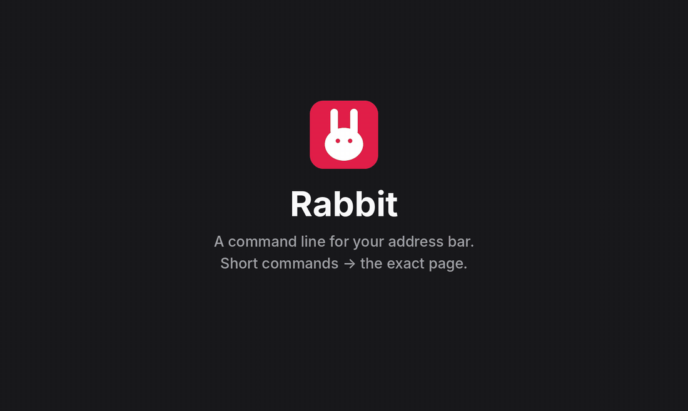

<p align="center">
  
</p>

<h1 align="center">Rabbit</h1>

<p align="center">
  A command line for Chrome's address bar. Type a short command, land on the exact page.<br>
  <sub>Inspired by bunnylol. Built from scratch.</sub>
</p>

<p align="center">
  <a href="../../actions/workflows/test.yml"></a>
</p>

<p align="center">
  
</p>
<p align="center"><sub>Real captures from Chrome. The bar on top is a caption of what was typed. Private details are blurred. <a href="docs/media/demo.mp4">MP4</a></sub></p>

```
gm citibike              → Gmail search for "citibike"
gh react                 → GitHub search
ghpr facebook/react 1    → that pull request             (code command)
cal tomorrow             → tomorrow in Google Calendar   (code command)
tr es good morning       → Google Translate              (code command)
g gm                     → force a Google search for "gm"
rabbit                   → list and edit every command
anything else            → normal Google search, untouched
```

No server and no account. Commands live in `chrome.storage.sync`, so they follow your Chrome profile across machines.

## Install

1. Clone this repo.
2. Open `chrome://extensions` and turn on **Developer mode**.
3. Click **Load unpacked** and choose the repo folder.

With Google as your default search engine, just type commands into the address bar. Or type `b`, then space, for autocomplete suggestions.

## Commands

Open the command list by typing `rabbit` (or `rh`, `bunny`, `help`). Each command has:

| Field | Used when | Example |
| --- | --- | --- |
| **Aliases** | always | `gm,mail` |
| **URL** | typed alone | `https://mail.google.com` |
| **Search template** | typed with words after it. `%s` is URL-encoded, `%S` is raw | `https://mail.google.com/mail/u/0/#search/%s` |
| **Code** | optional JS; replaces URL and search | see below |

You can also click the toolbar icon to save the current page as a command, or type `add hn https://news.ycombinator.com` anywhere.

## Code commands

For anything a template can't express, such as parsing an ID, branching on arguments or opening several tabs, write a function body:

```js
// ghpr facebook/react 123
const [repo, n] = args;               // args: words after the command
if (!repo) return "https://github.com/pulls";
return n ? `https://github.com/${repo}/pull/${n}` : `https://github.com/${repo}/pulls`;
```

- In scope: `args` (array), `q` (raw string after the command), `enc` (`encodeURIComponent`).
- Return a URL, or an array of URLs to open several tabs. `await` and `fetch` work (5 s timeout).
- Each editor has a Run box to try the snippet with sample arguments.
- If a command throws, you land in its editor with the error.

## How it works

```
address bar ──► Google search URL (sourceid=chrome)
                     │  webNavigation.onBeforeNavigate
                     ▼
             background service worker ──► resolve(command)
                     │                         │
                     │ URL / template          │ code
                     ▼                         ▼
               tabs.update(url)     offscreen document ──► sandboxed iframe
                                                             (eval allowed, no chrome.* APIs)
```

- **No keyword needed.** When you type into the address bar, Chrome sends it to Google with `sourceid=chrome`. The service worker watches for that and redirects only if the first word is a command. Everything else continues to Google untouched.
- **User-written code under Manifest V3.** MV3 bans `eval` in extension pages and service workers, and service workers can't host iframes. So code goes from the worker to an offscreen document, which forwards it by `postMessage` to `sandbox.html`. That's a manifest sandbox page: it's allowed to `eval`, but it has an opaque origin and no `chrome.*` APIs. It only ever sees the arguments, and only returns strings.
- **Storage.** `chrome.storage.sync` caps each item at 8 KB, so the command list is stored in chunks.

## Development

```sh
npm test                                  # unit tests: parsing, templates, every built-in code command
npx playwright install chromium
npm run test:e2e                          # loads the real extension in Chromium and checks redirects
```

The end-to-end suite stubs the network, so it runs offline and in CI.

| File | Role |
| --- | --- |
| `lib.js` | parsing, resolving, storage (shared) |
| `background.js` | address-bar interception, `b` keyword, code execution |
| `options.*` | command editor (the `rabbit` page) |
| `popup.*` | "add this page" |
| `sandbox.*`, `sandbox-client.js`, `offscreen.*` | runs code commands |

## License

MIT
